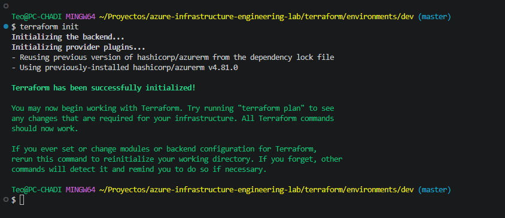
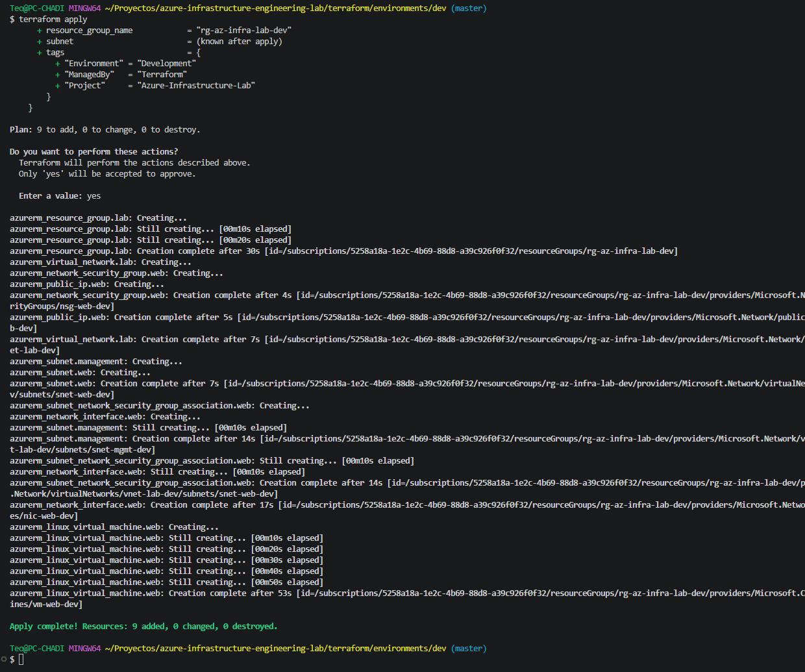

# ☁️ Azure Infrastructure Engineering Lab


A hands-on cloud infrastructure project focused on provisioning, validating, securing, and managing Microsoft Azure resources using Terraform (Infrastructure as Code).

The project demonstrates practical cloud engineering principles, infrastructure automation, network segmentation, Linux administration, SSH security, and resource lifecycle management.

---

## 📑 Table of Contents

- [Project Overview](#-project-overview)
- [Architecture](#-architecture)
- [Network Design](#-network-design)
- [Security](#-security)
- [Technology Stack](#-technology-stack)
- [Repository Structure](#-repository-structure)
- [Prerequisites](#-prerequisites)
- [Deployment](#-deployment)
- [Validation](#-validation)
- [Cost Management](#-cost-management)
- [Implementation Evidence](#-implementation-evidence)
- [Future Improvements](#-future-improvements)
- [Author](#-author)

---

## 🎯 Project Overview

The objective is to design and deploy a foundational Azure infrastructure environment using Terraform.

The infrastructure includes:

- Azure Resource Group.
- Virtual Network (VNet).
- Network segmentation using dedicated subnets.
- Network Security Group (NSG).
- Static Public IP address.
- Network Interface Card (NIC).
- Ubuntu Linux Virtual Machine.

The infrastructure lifecycle is managed through Terraform, allowing repeatable provisioning, validation, and cleanup.

## 🏗️ Architecture

### Azure Networking

- Resource Group.
- Virtual Network (VNet).
- Web subnet.
- Management subnet.
- Network Security Group (NSG).
- NSG subnet association.

### Compute

- Ubuntu Server 24.04 LTS.
- Azure Linux Virtual Machine.
- Static Public IP.
- Network Interface Card (NIC).
- Dedicated OS disk.
- SSH authentication using Ed25519.

### Architecture Diagram


## 🌐 Network Design

The environment uses a dedicated address space with subnet segmentation.

| Component | CIDR | Purpose |
|---|---|---|
| Virtual Network | `10.10.0.0/16` | Main network address space |
| Web Subnet | `10.10.1.0/24` | Linux workload |
| Management Subnet | `10.10.2.0/24` | Reserved for management workloads |

The Management subnet is provisioned as part of the network design but does not currently host a deployed workload.

## 🔐 Security

Security controls implemented in this laboratory:

- SSH access restricted to the administrator's public IP address (`/32`).
- SSH public-key authentication using Ed25519.
- Password authentication disabled.
- Network Security Group inbound traffic filtering.
- Terraform state and sensitive variable files excluded from version control.

**Security consideration:** Public IP-based SSH access is used for this laboratory. For production environments, private administration through Azure Bastion or another controlled access architecture should be evaluated.

## 🧰 Technology Stack

| Technology | Purpose |
|---|---|
| Microsoft Azure | Cloud infrastructure platform |
| Terraform | Infrastructure as Code |
| AzureRM Provider | Azure resource management |
| Ubuntu Server 24.04 LTS | Linux compute workload |
| Azure CLI | Azure resource validation |
| SSH Ed25519 | Secure remote administration |
| Git & GitHub | Version control and documentation |

## 📁 Repository Structure

```text
azure-infrastructure-engineering-lab/
│
├── README.md
├── .gitignore
│
├── docs/
│   └── architecture/
│       └── azure-lab-architecture.png
│
├── evidence/
│   └── screenshots/
│       ├── 00-terraform-init.png
│       ├── 01-terraform-plan.png
│       ├── 02-terraform-apply.png
│       ├── 03-azure-resources.png
│       ├── 04-linux-ssh.png
│       └── 05-terraform-destroy.png
│
└── terraform/
    └── environments/
        └── dev/
            ├── main.tf
            ├── variables.tf
            └── .terraform.lock.hcl
```

## 📋 Prerequisites

Before deploying the infrastructure, ensure the following tools and requirements are available:

- An active Microsoft Azure subscription.
- Terraform CLI.
- Azure CLI.
- Git.
- An SSH Ed25519 key pair.
- An authenticated Azure CLI session or another supported Azure authentication method.

Authenticate to Azure using Azure CLI:

```bash
az login
```

Verify the active subscription:

```bash
az account show
```

Select the appropriate subscription if necessary:

```bash
az account set --subscription "<SUBSCRIPTION_ID>"
```

## 🚀 Deployment

Navigate to the Terraform environment directory:

```bash
cd terraform/environments/dev
```

### 1. Initialize Terraform

```bash
terraform init
```

### 2. Validate the configuration

```bash
terraform validate
```

### 3. Review the execution plan

```bash
terraform plan
```

Review the proposed infrastructure changes before proceeding.

### 4. Deploy the infrastructure

```bash
terraform apply
```

Review the execution plan and explicitly approve the deployment when prompted.

### 5. Destroy the infrastructure

After completing all validation activities:

```bash
terraform destroy
```

This removes the Terraform-managed laboratory resources from Azure.

**Important:** Review the Terraform plan before applying or destroying resources. These commands can create or remove billable cloud resources.

## 🧪 Validation

The following activities were performed during the implementation:

- Azure Resource Group provisioning.
- VNet and subnet creation and validation.
- Network Security Group configuration and verification.
- Linux Virtual Machine provisioning.
- SSH connectivity validation.
- Terraform state validation.
- Infrastructure destruction after testing.
- Azure resource cleanup verification.

## 💰 Cost Management

This laboratory uses Azure resources that may generate charges while deployed.

Cost-control practices:

- Infrastructure was deployed temporarily for validation.
- The Linux Virtual Machine and associated resources were destroyed after testing.
- Resource cleanup was verified after the deployment lifecycle.
- No unnecessary resources were intentionally retained.

Always review Azure pricing and the estimated cost of resources before deployment.

## 📸 Implementation Evidence

The following screenshots document the infrastructure lifecycle, from Terraform initialization to final resource cleanup.

### ⚙️ 1. Terraform Initialization



### 📋 2. Terraform Plan


### 🚀 3. Terraform Apply



### ☁️ 4. Azure Resources


### 🐧 5. Linux SSH Connectivity


### 🧹 6. Terraform Destroy


## 🔭 Future Improvements

Potential enhancements for future iterations:

- Remote Terraform state using Azure Storage.
- Reusable Terraform modules.
- Azure Bastion and private administration.
- Private networking architecture.
- Application Gateway integration.
- Azure Monitor and centralized logging.
- CI/CD automation using GitHub Actions.
- Azure Policy and governance controls.

## 👨‍💻 Author

**Teodoro Diaz**

Cloud & Infrastructure Engineer

[GitHub](https://github.com/teodoro-diaz) | [LinkedIn](https://www.linkedin.com/in/teodorodiazcha/)

---

*This project is part of a practical cloud engineering portfolio focused on Azure infrastructure, Terraform automation, security, and operational best practices.*