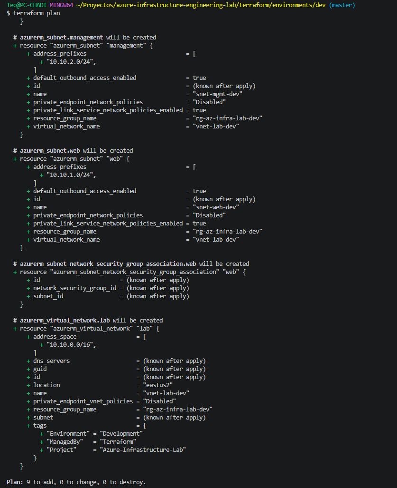
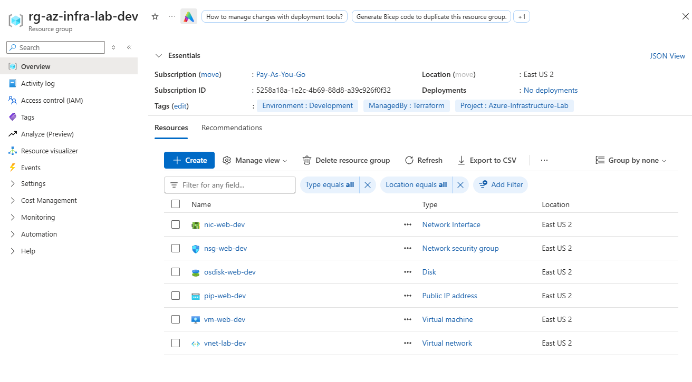
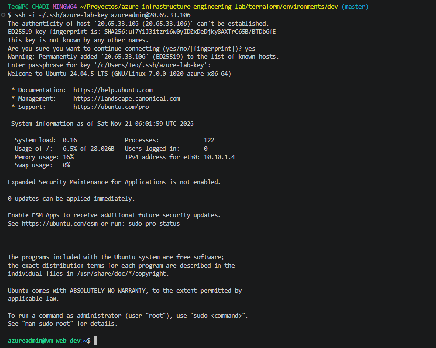
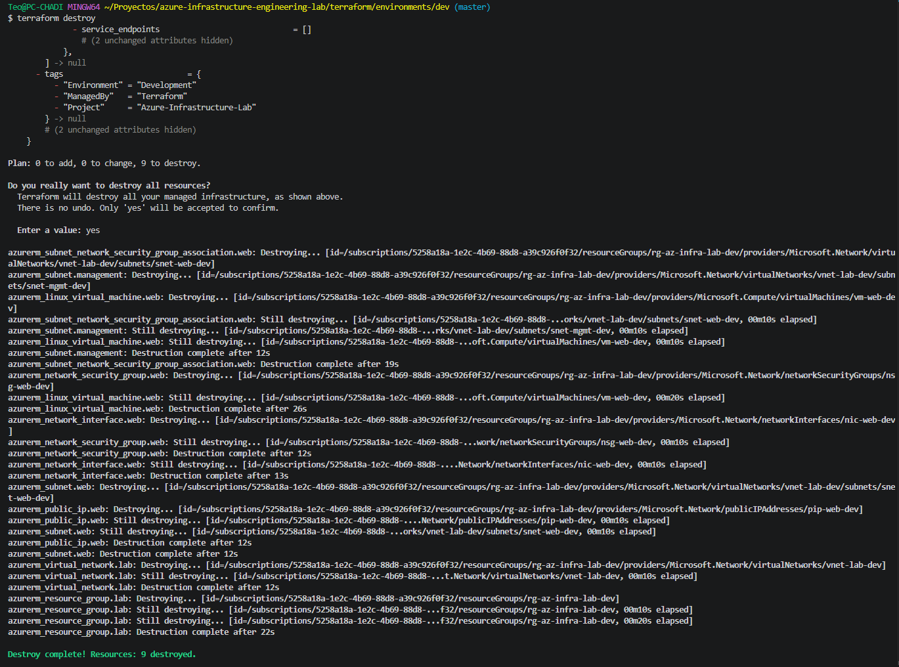

# Azure Infrastructure Engineering Lab

## Overview

Hands-on Azure infrastructure project using Terraform (Infrastructure as Code).

The objective is to design, deploy, validate, secure, and destroy Azure infrastructure following cloud engineering best practices.

## Architecture

### Azure Networking

- Resource Group
- Virtual Network (VNet)
- Web subnet
- Management subnet
- Network Security Group (NSG)
- NSG subnet association

### Compute

- Ubuntu Server 24.04 LTS
- Azure Linux Virtual Machine
- Static Public IP
- SSH authentication using Ed25519
- Password authentication disabled
- Dedicated OS disk

## Network Addressing

| Component | CIDR |
|---|---|
| VNet | 10.10.0.0/16 |
| Web subnet | 10.10.1.0/24 |
| Management subnet | 10.10.2.0/24 |

## Security

- SSH access restricted to administrator public IP (/32).
- SSH key-based authentication.
- Password authentication disabled.
- Network Security Group inbound filtering.
- Terraform state and sensitive variables excluded from Git.

## Infrastructure as Code

Terraform manages the infrastructure lifecycle.

```bash
terraform init
terraform plan
terraform apply
terraform destroy
```

Terraform configuration:

```text
terraform/
└── environments/
    └── dev/
        ├── main.tf
        ├── variables.tf
        └── .terraform.lock.hcl
```

## Validation

- Azure resources provisioned successfully.
- VNet and subnets validated using Azure CLI.
- NSG rules verified.
- Linux VM provisioning validated.
- SSH connectivity successfully established.
- Terraform state validated.
- Infrastructure successfully destroyed.

## Cost Management

Resources were deployed temporarily for laboratory purposes.

The VM, Public IP, and associated infrastructure were destroyed after validation to prevent unnecessary Azure charges.

## Repository Security

The following files are excluded from version control:

- terraform.tfstate
- terraform.tfstate.backup
- terraform.tfvars
- .terraform/

## Future Improvements

- Terraform remote state with Azure Storage.
- Modular Terraform architecture.
- Azure Bastion or private administration.
- Application Gateway.
- Monitoring and logging.
- CI/CD with GitHub Actions.
- Azure Policy and governance.

## Author

**Teodoro Diaz**<br>
Cloud & Infrastructure Engineer<br>
[GitHub](https://github.com/teodoro-diaz) |
[LinkedIn](https://www.linkedin.com/in/teodorodiazcha/)


## Architecture Diagram


## 📸 Implementation Evidence

Visual evidence collected during the deployment, validation, and cleanup of the Azure infrastructure using Terraform.

### ⚙️ 1. Terraform Initialization


### 📋 2. Terraform Plan



### 🚀 3. Terraform Apply


### ☁️ 4. Azure Resources



### 🐧 5. Linux SSH Connectivity



### 🧹 6. Terraform Destroy



---

### ✅ Deployment Summary

- Infrastructure provisioned successfully using Terraform.
- Azure networking and Linux virtual machine validated.
- SSH connectivity verified using Ed25519 authentication.
- Infrastructure successfully destroyed after validation.
- Azure resource cleanup verified.
